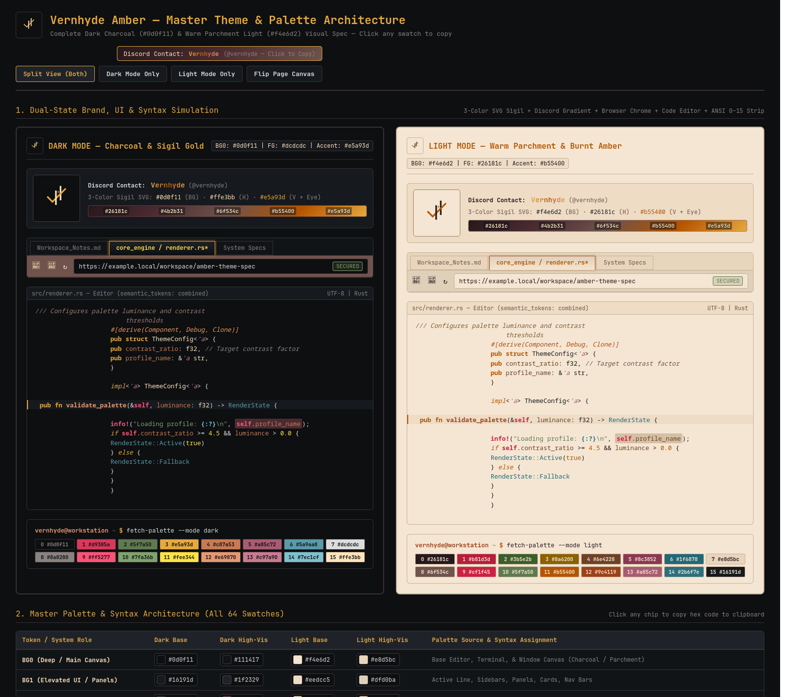

# Vernhyde Amber — Dual-State Theme & Syntax Architecture

**Eye-safe Dark Charcoal (`#0d0f11`) & Warm Parchment Light (`#f4e6d2`) theme suite across Zed, Ghostty, KDE Plasma, Firefox, Discord, and Android.**

---

## Visual Overview (Dark & Light Mode)

> **Interactive Swatch & UI Tester:** Open the **[Live GitHub Pages Spec Sheet](https://vernhyde.github.io/CUSTOM_THEMES/)** to toggle between Split View, Dark Mode, and Light Mode, or click any of the 64 swatches to copy its hex code.

---

## Master Palette & Syntax Architecture

| Token / System Role | Dark Base | Dark High-Vis | Light Base | Light High-Vis | Palette Source & Syntax Assignment |
| :--- | :--- | :--- | :--- | :--- | :--- |
| **BG0 (Main Canvas)** | `#0d0f11` | `#111417` | `#f4e6d2` | `#e8d5bc` | Base Editor, Terminal, & Window Canvas |
| **BG1 (Elevated UI)** | `#16191d` | `#1f2329` | `#eedcc5` | `#dfd0ba` | Active Line, Sidebars, Panels, Nav Bars |
| **BG2 (Selection / Tint)** | `#26181c` | `#4b2b31` | `#e5cdab` | `#d4c0a5` | Selection Background, Diff/Highlight Tint |
| **UI Border / Muted** | `#3a3235` | `#53383d` | `#c4b097` | `#997b73` | Split Borders, Inactive Tabs, Gutter |
| **Original Dark Earth** | `#6f534c` | `#593d45` | `#6f534c` | `#593d45` | Dark Nav Bar, Subtle UI Badges, Fold Markers |
| **Comment / Muted FG** | `#8a8280` | `#afabaa` | `#6f534c` | `#53383d` | Comments, Punctuation, Delimiters |
| **Doc Comment / Subtext** | `#997b73` | `#a8845e` | `#825c38` | `#6f534c` | Docstrings (`///`, `//!`), Subtext |
| **Primary Foreground** | `#dcdcdc` | `#ffe3bb` | `#26181c` | `#16191d` | Default Text, Variables, Types |
| **Primary Accent** | `#e5a93d` | `#ffa72e` | `#b55400` | `#9c4119` | Keywords, Operators, Tags, Cursor |
| **Canyon Ochre** | `#f09654` | `#ffa72e` | `#b04818` | `#c87a53` | Rust Attributes (`#[...]`), Derive Traits |
| **ANSI Red (Crimson)** | `#d9385a` | `#ff5277` | `#b81d3d` | `#cf1f45` | Macros (`info!`), `self`, Errors, Deletions |
| **ANSI Green (M81 Moss)** | `#5f7a50` | `#7fa36b` | `#3b5e2b` | `#5f7a50` | Strings, Text Literals, Git Additions |
| **ANSI Yellow (Bronze)** | `#e5a93d` | `#fee344` | `#8a6200` | `#b55400` | Numbers, Booleans, Constants |
| **ANSI Blue (Ochre / Horn)**| `#c87a53` | `#e69870` | `#6e4228` | `#9c4119` | Functions (`#e69870`/`#9c4119`), Properties |
| **ANSI Magenta (Plum)** | `#a85c72` | `#c97a90` | `#8c3852` | `#a85c72` | Rust Lifetimes (`'a`), Loop Labels |
| **ANSI Cyan (Slate)** | `#5a9aa8` | `#7ec1cf` | `#1f6878` | `#2b6f7e` | Escape Chars (`\n`), Enum Variants |

---

## Discord & Brand Presets

* **Contact:** `@vernhyde` on Discord
* **3-Color SVG Logo (Dark):** `#0d0f11` (Canvas) · `#ffe3bb` (H-Bars) · `#e5a93d` (V-Check & Eye)
* **3-Color SVG Logo (Light):** `#f4e6d2` (Canvas) · `#26181c` (H-Bars) · `#b55400` (V-Check & Eye)
* **Discord 5-Stop Custom Theme Gradient (`135°`):** `#26181c` → `#4b2b31` → `#6f534c` → `#b55400` → `#e5a93d`
* **Discord 5-Stop Prism Display Name:** `#e5a93d` → `#d48826` → `#b55400` → `#c87a53` → `#e5a93d`
